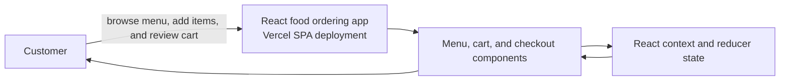

# Food Order App - React

## Architecture

## Description

A Wholesome Project to practice React Hooks including State, Side Effects, Reducer, Context - The Complete Guide by Academind

## Getting Started

### Dependencies

* React
* ReactDOM

### Concepts Include

1. Components & JSX
2. useState
3. Fragments
4. Ref
5. Portal
6. useEffect
7. useReducer
8. useContext
9. Structuring the Folders
10. Global State Maintaining

### Working with Project

To get the frontend running locally:

* Clone this repo
* `npm install` to install all required dependencies
* `npm run dev` to start the local server (this project Vite)

## Author

* Website - [Muhammad Saad](https://zaap.bio/itxSaaad)

## 🔗 Links

* Frontend Mentor - [@itxSaaad](https://www.frontendmentor.io/profile/itxSaaad)
* Twitter - [@itxSaaad](https://www.twitter.com/itxSaaad)
* Github: [@itxSaaad](https://github.com/itxSaaad)
* LinkedIn: [@itxSaaad](https://linkedin.com/in/itxSaaad)

## Support Me

## Vercel Deployment
Vite SPA served from the repository root; client-side routes rewrite to index.html.
See the repository-root [vercel.json](./vercel.json) for build roots and routing. Configure private values in Vercel Project Settings; never commit secrets.

